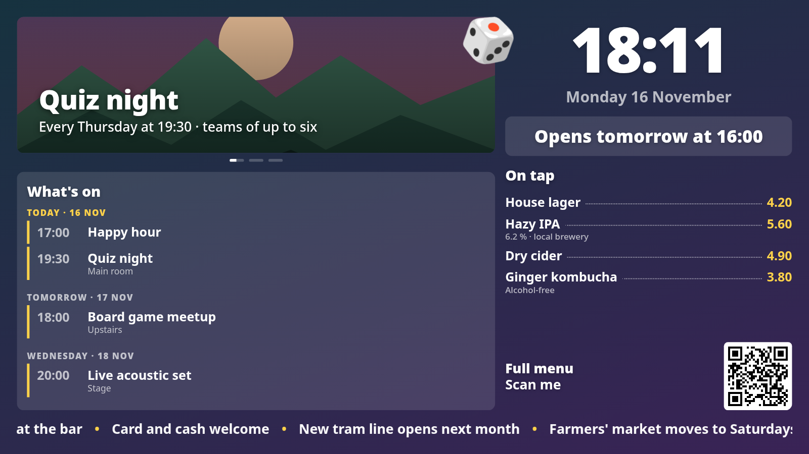
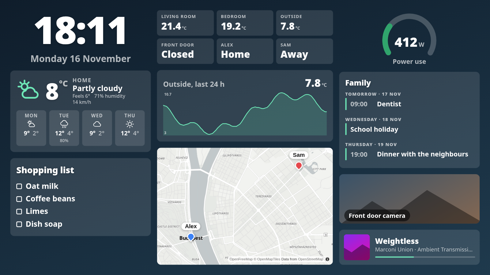
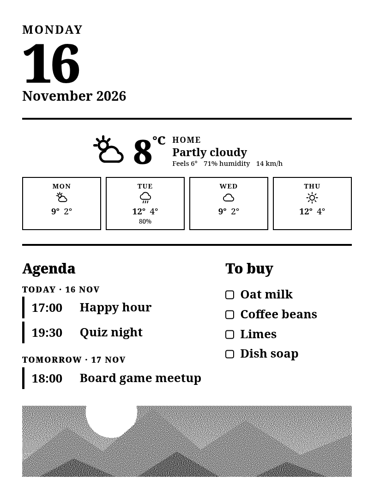
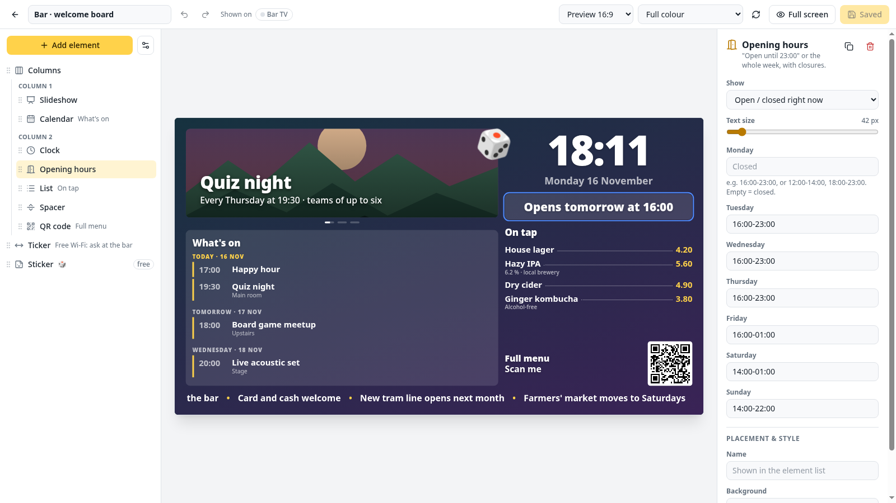
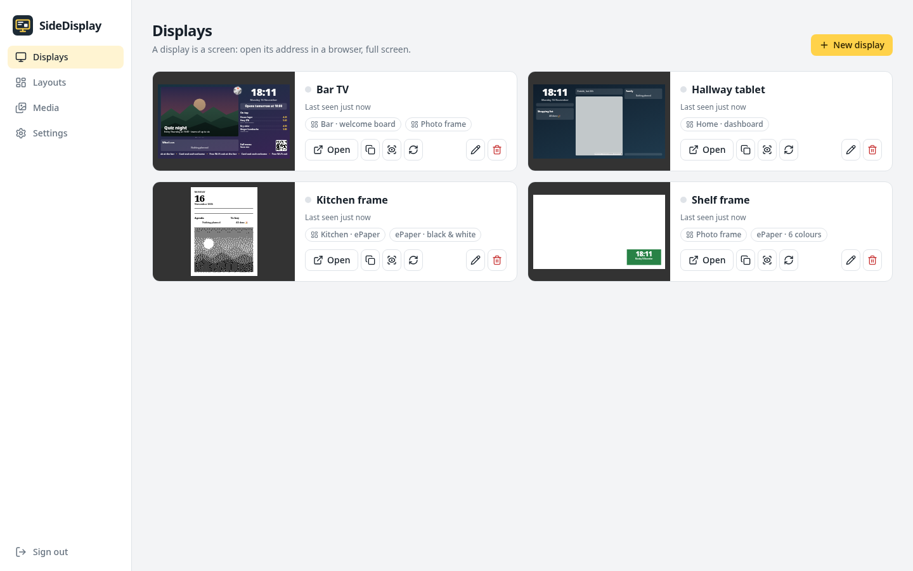
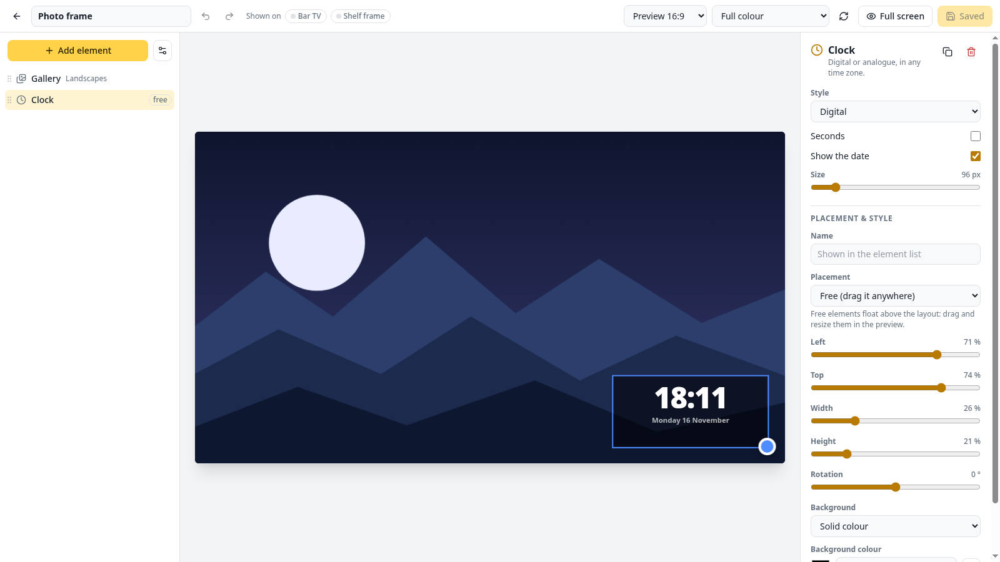
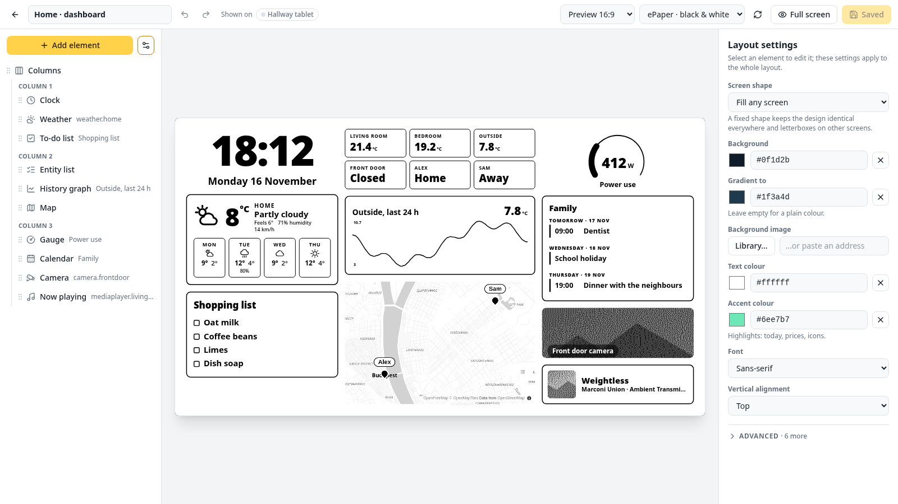

# SideDisplay

Design a screen in your browser, then show it on anything that can open a web
page: the TV behind the bar, an old tablet in the hallway, an ePaper frame in
the kitchen.

SideDisplay is a small self-hosted app. You build **layouts** out of elements
(clock, weather, calendar, photos, video, maps, Home Assistant data…), assign
them to **displays**, and open each display's address on a screen. Change a
layout and every screen showing it updates within a second.



| Home Assistant dashboard                                              | ePaper, black & white                                    |
| --------------------------------------------------------------------- | -------------------------------------------------------- |
|  |  |

## What it does

- **58 elements**: text, images, galleries, slideshows, video (files and
  YouTube), web pages, QR codes, tickers, lists, stickers, clocks, dates,
  countdowns, calendars (iCal and Home Assistant), opening hours, weather,
  MapLibre maps, news feeds, eight Home Assistant elements and two for MQTT.
  [Full reference](docs/elements.md).
- **A layout system with freedom where you want it**: elements stack and sit
  in columns by default; switch any of them to _free_ and drag it anywhere,
  like a sticker in a corner.
- **Simple first, detailed when needed**: every element shows a handful of
  everyday options, with the rest one click away under _Advanced_.
- **Live preview**: the editor shows the real renderer, with real data.
- **ePaper modes**: greyscale, black & white and 6-colour screens get a
  high-contrast rendering without animations, and dithered pictures.
- **Home Assistant**: show entities, graphs, cameras, to-do lists and what is
  playing, and show or hide any element depending on an entity's state.
- **MQTT**: show what sensors and devices publish on a broker, the moment
  they publish it.
- **Playlists and schedules**: a display can cycle through layouts, and show
  some only on certain days or hours.
- **Built for unattended screens**: displays keep their last content when the
  network drops, reconnect by themselves, and can dim at night.
- **Read-only by design**: displays take no input. One password protects the
  admin interface; there are no accounts to manage.



## Try it in one minute

With [Bun](https://bun.com) 1.4 or newer:

```sh
git clone https://github.com/SideQuestBar/side-display.git
cd side-display
bun install
bun run demo
```

Open <http://localhost:4380> and sign in with the password `sidedisplay`. The
demo comes with sample layouts and a simulated Home Assistant, in a temporary
folder: nothing is kept.

## Install

### Docker

```sh
docker run -d --name sidedisplay \
  -p 4380:4380 \
  -v sidedisplay-data:/data \
  --restart unless-stopped \
  ghcr.io/sidequestbar/side-display:latest
```

Open <http://localhost:4380> and choose a password. Everything (database and
uploaded media) lives in the `/data` volume.

Prefer Compose? Use the [`docker-compose.yml`](docker-compose.yml) in this
repository: `docker compose up -d`.

### Home Assistant app

1. In Home Assistant, go to **Settings → Apps → App store**, open the **⋮**
   menu, choose **Repositories** and add
   `https://github.com/SideQuestBar/side-display`.
2. Install **SideDisplay** and start it.
3. Open it from the sidebar. Home Assistant entities are available right away,
   with nothing to configure.

Screens open displays on the app's own port:
`http://<home assistant address>:4380/d/<display id>`.
More in [docs/home-assistant.md](docs/home-assistant.md).

### Coolify and other platforms

SideDisplay is a single container listening on port `4380` with one volume at
`/data`. On Coolify, create a _Docker Image_ resource from
`ghcr.io/sidequestbar/side-display:latest` (or point it at this repository's
`Dockerfile`), add persistent storage mounted at `/data`, and set the exposed
port to `4380`. Details and reverse-proxy notes are in
[docs/deployment.md](docs/deployment.md).

### From source

```sh
bun install
bun run build   # builds the web interface
bun run start   # http://localhost:4380, data in ./data
```

## How it works

|             |                                                                                                              |
| ----------- | ------------------------------------------------------------------------------------------------------------ |
| **Layout**  | One screenful: elements on a background. Built in the editor.                                                |
| **Display** | A screen. It has one or more layouts and settings such as its colour mode. Each display has its own address. |
| **Media**   | Your pictures and videos. Albums feed gallery elements.                                                      |

Layouts can be filed in folders. Layouts and displays you no longer use can be
archived: they leave the main lists, stay as they were under _Archived_, and can
be restored at any time. An archived display's address keeps working.

1. Create a layout (start from a template) and save it.
2. Create a display and add the layout to it.
3. Open the display's address on the screen, full screen. In Chromium:
   `chromium --kiosk http://server:4380/d/<display id>`. For a screen that
   runs unattended, [docs/screens.md](docs/screens.md) shows how to set up a
   Raspberry Pi with DietPi or an Android tablet with FreeKiosk.

A display's address works without signing in, because TVs and ePaper frames
cannot type a password. It contains a random id: treat it like a share link.



Elements follow the layout by default. Set one to _free_ and it can be dragged
and resized anywhere on top of it:



## ePaper screens

Set a display's **Screen type** to greyscale, black & white or 6 colours.
Layouts then render on a white page with solid ink: no animation, shadows or
gradients, and pictures dithered to the panel's colours. The editor can preview
any layout in each mode.



More in [docs/epaper.md](docs/epaper.md).

## Configuration

Everything can be set in the interface. These environment variables are all
optional:

| Variable                    | Default                      | Purpose                                                                  |
| --------------------------- | ---------------------------- | ------------------------------------------------------------------------ |
| `SIDEDISPLAY_PORT`          | `4380`                       | Port to listen on.                                                       |
| `SIDEDISPLAY_HOST`          | `0.0.0.0`                    | Address to listen on.                                                    |
| `SIDEDISPLAY_DATA_DIR`      | `./data` (`/data` in Docker) | Database and media.                                                      |
| `SIDEDISPLAY_PASSWORD`      | –                            | Sets the admin password at every start, instead of the first-run screen. |
| `SIDEDISPLAY_HA_URL`        | –                            | Home Assistant address, e.g. `http://homeassistant.local:8123`.          |
| `SIDEDISPLAY_HA_TOKEN`      | –                            | A Home Assistant long-lived access token.                                |
| `SIDEDISPLAY_MQTT_URL`      | –                            | MQTT broker, e.g. `mqtt://192.168.1.10:1883` (`mqtts://` for TLS).       |
| `SIDEDISPLAY_MQTT_USERNAME` | –                            | User name for the broker, if it needs one.                               |
| `SIDEDISPLAY_MQTT_PASSWORD` | –                            | Password for the broker.                                                 |
| `SIDEDISPLAY_MAX_UPLOAD_MB` | `500`                        | Largest upload accepted.                                                 |

**Backups**: copy the data directory (or the Docker volume). It holds
`sidedisplay.db` and the `media` folder.

## Documentation

- [Elements](docs/elements.md): every element and its options
- [Home Assistant](docs/home-assistant.md): the app, the connection, tips
- [MQTT](docs/mqtt.md): the broker, topics, values inside JSON messages
- [Deployment](docs/deployment.md): Docker, Coolify, reverse proxies
- [Screens](docs/screens.md): kiosk setup with DietPi (TVs, monitors) and FreeKiosk (Android tablets)
- [ePaper](docs/epaper.md): what the low-colour modes do
- [Development](docs/development.md): how the code is organised, adding an element

## Development

```sh
bun install
bun run dev         # server + client, rebuilt on change
bun test            # unit and API tests
bun run lint        # Biome
bun run typecheck
```

Built with [Bun](https://bun.com), [Elysia](https://elysiajs.com),
[SolidJS](https://www.solidjs.com), [Drizzle](https://orm.drizzle.team) on
SQLite, [Tailwind CSS](https://tailwindcss.com) and [Biome](https://biomejs.dev).
[docs/development.md](docs/development.md) explains the structure.

Bug reports and pull requests are welcome. Please run `bun run lint`,
`bun run typecheck` and `bun test` before sending a change.

## Credits

Maps are drawn with [MapLibre GL JS](https://maplibre.org) using
[OpenFreeMap](https://openfreemap.org) tiles (data © OpenStreetMap
contributors). Weather comes from [Open-Meteo](https://open-meteo.com). Icons
are from [Lucide](https://lucide.dev).

## License

SideDisplay is free software, released under the
[GNU General Public License v3.0](LICENSE) or later.
