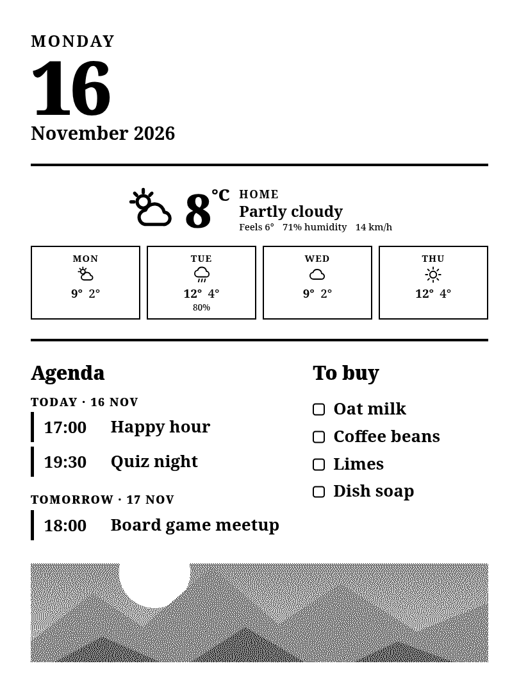
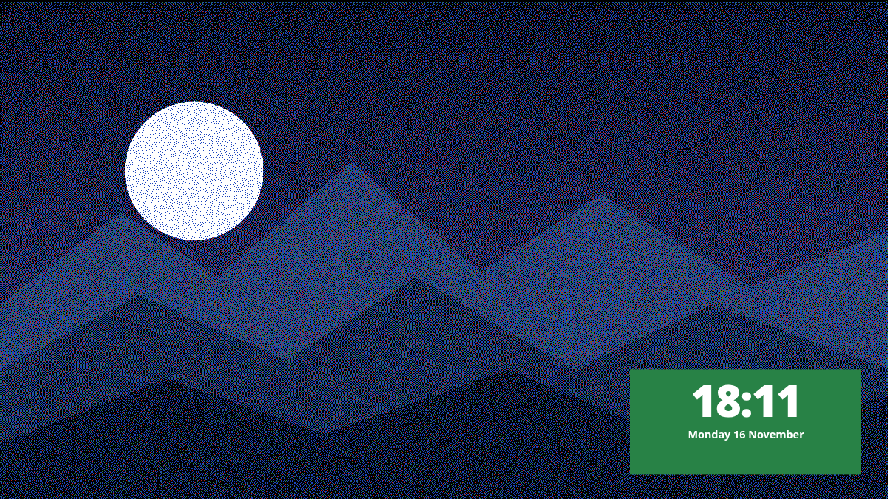

# ePaper screens

ePaper is slow, has few colours and ghosts when pixels change often. A layout
made for a TV would look washed out on it, so each display has a **Screen
type** that changes how layouts are drawn.

| Screen type            | For                                                           | Pictures                    |
| ---------------------- | ------------------------------------------------------------- | --------------------------- |
| Full colour            | TVs, monitors, tablets                                        | As they are                 |
| ePaper · greyscale     | 16-level grey panels                                          | Converted to grey           |
| ePaper · black & white | 1-bit panels                                                  | Dithered to black and white |
| ePaper · 6 colours     | Spectra-style panels (black, white, red, yellow, blue, green) | Dithered to those six inks  |



## What changes in the ePaper modes

- The page is white with black text (or the reverse, with _White on black_).
  The layout's background colour, gradient and image are ignored.
- Nothing animates: no transitions, no scrolling ticker (its messages are
  shown as one line), no seconds on clocks, no progress bars.
- Shadows and translucent panels are replaced by solid outlines.
- Colours you picked are mapped to the nearest ink. In black & white, an
  accent colour becomes black rather than disappearing.
- Pictures are dithered in the browser (Floyd–Steinberg) to the panel's inks,
  which keeps photos readable instead of letting the panel threshold them.
- Videos show their poster image.

Every element has **Screens** under _Advanced_: use it to show an element only
on colour screens, or only on ePaper, when one layout serves both.



## Designing for ePaper

- Start from the **ePaper agenda** template, and lock the layout's **Screen
  shape** to your panel's ratio (3:4, 5:3…) so it fits exactly.
- Preview in the editor with the colour-mode selector in the toolbar.
- Prefer few, large elements. Thin lines and small text suffer on low-resolution
  panels.
- Avoid elements that change every few seconds. A gallery or slideshow with an
  interval of several minutes is fine.

## Getting the page onto the panel

SideDisplay renders in a browser, so the frame needs one:

- **Frames with a browser** (many Android-based ePaper tablets and signage
  frames): open the display's address in kiosk mode, for example with
  FreeKiosk (see [screens.md](screens.md)).
- **Microcontroller frames** (ESP32 and similar) cannot run a browser. Render
  the display with a headless browser on another machine and send the
  screenshot to the frame. For example, on a schedule:

  ```sh
  chromium --headless --screenshot=frame.png --window-size=800,480 \
    --virtual-time-budget=8000 http://server:4380/d/<display id>
  ```

  Set the display's screen type to match the panel, so the screenshot only
  contains colours the panel can show.

Tip: `?mode=mono` (or `gray`, `color6`) on a display's address forces a mode,
to check a layout from any browser.
