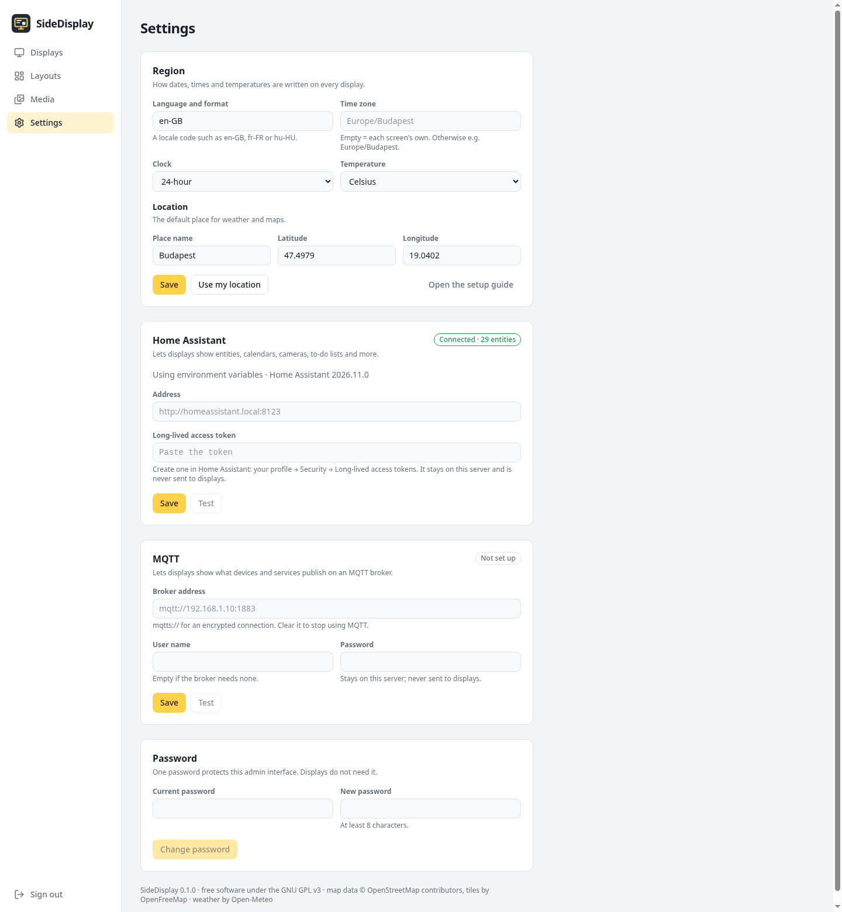

# Home Assistant

SideDisplay can run inside Home Assistant as an app, or anywhere else and
connect to Home Assistant over the network. Either way, the same elements
become available.

## As a Home Assistant app

1. **Settings → Apps → App store → ⋮ → Repositories**, add
   `https://github.com/SideQuestBar/side-display`.
2. Install **SideDisplay**, start it, and turn on **Show in sidebar**.
3. Open it from the sidebar. You are signed in by Home Assistant, and the
   connection to your entities needs no setup.

### Opening displays

Screens cannot sign in to Home Assistant, so displays are not opened through
the sidebar address. They use the app's own port:

```
http://<home assistant address>:4380/d/<display id>
```

The **Open** and **Copy** buttons on the Displays page give the id. If you
changed the port in the app's **Network** settings, use that port.

### Managing displays outside the sidebar

`http://<home assistant address>:4380` also serves the admin interface. It
stays closed until you choose a password under **Settings**, from the sidebar.
Without one, that address only says so.

Uploads through the sidebar pass through Home Assistant's proxy, which limits
their size. For large videos, sign in on port 4380 and upload there.

## Connecting from elsewhere (Docker, Coolify…)

1. In Home Assistant, open your profile, then **Security → Long-lived access
   tokens**, and create a token.
2. In SideDisplay, open **Settings → Home Assistant**, enter the address
   (for example `http://homeassistant.local:8123`) and the token, then **Test**
   and **Save**.

The same can be set with `SIDEDISPLAY_HA_URL` and `SIDEDISPLAY_HA_TOKEN`.

SideDisplay must be able to reach Home Assistant; screens do not need to. The
token stays on the SideDisplay server: a display only ever receives the values
of the elements placed on its layouts.



## What you can show

| Element           | Shows                                              |
| ----------------- | -------------------------------------------------- |
| **Entity**        | One value, big: a temperature, a door, a counter.  |
| **Entity list**   | Several values as rows or tiles.                   |
| **Gauge**         | A number on a dial or bar, coloured by thresholds. |
| **History graph** | How a sensor moved over the last hours.            |
| **Camera**        | Snapshots from a camera or image entity.           |
| **Now playing**   | A media player's title, artist and artwork.        |
| **To-do list**    | A to-do or shopping list.                          |
| **Template**      | Any text a Home Assistant template can produce.    |
| **Weather**       | A `weather` entity, with its daily forecast.       |
| **Calendar**      | `calendar` entities, mixed with iCal feeds.        |
| **Map**           | `person` and `device_tracker` entities as markers. |

Values update as they change in Home Assistant, without waiting for a refresh.

## Showing elements only sometimes

Every element has, under **Advanced**, _Only when this entity… is in one of
these states_. For example:

- a "Welcome home" message only while `person.alex` is `home`;
- the front door camera only while `binary_sensor.front_door` is `on`;
- a sticker only while `input_boolean.party_mode` is `on`.

Several states can be listed, separated by commas: `on, open, unlocked`.

## Renaming states

Entity elements can rename states with _Rename states_, for example
`on=Open, off=Closed` or `home=At home, not_home=Away`.

## Troubleshooting

- **"Not connected"** in Settings: the message next to it comes from Home
  Assistant or the network. Check the address from the machine running
  SideDisplay, and that the token was copied whole.
- **An entity shows "–"**: it is `unavailable` or `unknown` in Home Assistant.
- **The entity picker is empty**: the connection is not up yet; entity ids can
  still be typed by hand.
