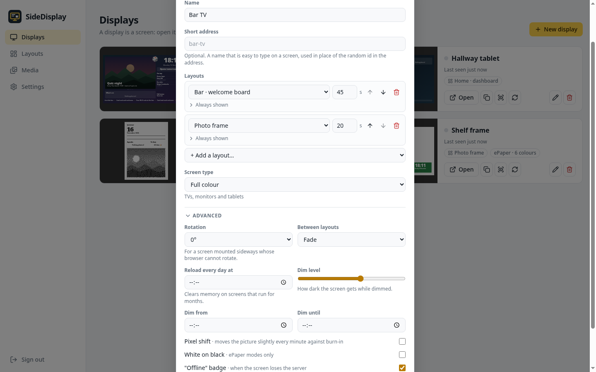

# Setting up a screen

A display is a web page: `http://server:4380/d/<display id>`. The **Open** and
**Copy** buttons on the Displays page give the exact address. To get one that
is easy to type on a TV remote, give the display a **Short address** when
editing it: `bar-tv` makes it open at `/d/bar-tv` as well. The id is random and
works like a share link; a short address can be guessed, so use one only for
displays that anyone on your network may see. Any device with a
recent browser can show it, but a screen that hangs on a wall for months needs
a bit more than a browser tab: it should start by itself after a power cut,
stay awake, and not show anything else.

Two free, open-source projects do this well, and they are what we recommend:

| You have                                     | Use                                                    |
| -------------------------------------------- | ------------------------------------------------------ |
| A TV or monitor                              | A Raspberry Pi or other small computer with **DietPi** |
| An Android tablet (or Android-based signage) | **FreeKiosk**                                          |

Other ways are listed [further down](#other-devices).

## What the page does by itself

Whatever shows it, the display page already takes care of these, so the device
does not have to:

- It follows changes made in the admin interface at once, and reloads itself
  when the server is updated.
- If the server or the network goes away, it keeps showing the last layout and
  reconnects on its own. A device that restarts while the server is away shows
  the layout it had last; only a screen that has never loaded shows
  "Connecting…" until the server answers.
- It hides the mouse pointer and asks the browser to keep the screen awake.
- Rotation, a daily reload, night dimming and pixel shift are
  [per-display settings](#display-settings-that-help).

## A TV or monitor: DietPi

[DietPi](https://dietpi.com/) is a minimal Debian image for the Raspberry Pi
and most other single-board computers, as well as ordinary PCs. It has a
ready-made mode that boots straight into full-screen Chromium with no desktop,
which is all a display needs. A Raspberry Pi 3 or newer is enough for most
layouts; take a Pi 4 or 5 for video or for several live elements at once.

### On a running DietPi

1. Write the image for your board to an SD card, boot it, and go through the
   first-run setup (see DietPi's
   [installation guide](https://dietpi.com/docs/install/)).
2. Install Chromium:

   ```sh
   dietpi-software install 113
   ```

3. Run `dietpi-autostart`, choose **11 : Chromium - Dedicated use without
   desktop**, and enter the display's address as the start page.
4. Set the screen's resolution in `/boot/dietpi.txt`, then reboot:

   ```ini
   SOFTWARE_CHROMIUM_RES_X=1920
   SOFTWARE_CHROMIUM_RES_Y=1080
   ```

To show another display later, run `dietpi-autostart` again or change
`SOFTWARE_CHROMIUM_AUTOSTART_URL` in `/boot/dietpi.txt`, and reboot.

### Without a keyboard

DietPi can set itself up unattended. After writing the image, open
`dietpi.txt` on the card's boot partition and set these before the first boot
(for Wi-Fi, also set `AUTO_SETUP_NET_WIFI_ENABLED=1` and fill in
`dietpi-wifi.txt`):

```ini
AUTO_SETUP_AUTOMATED=1
AUTO_SETUP_GLOBAL_PASSWORD=<choose one>
AUTO_SETUP_TIMEZONE=Europe/Budapest
AUTO_SETUP_INSTALL_SOFTWARE_ID=chromium
AUTO_SETUP_AUTOSTART_TARGET_INDEX=11
SOFTWARE_CHROMIUM_AUTOSTART_URL=http://server:4380/d/<display id>
SOFTWARE_CHROMIUM_RES_X=1920
SOFTWARE_CHROMIUM_RES_Y=1080
```

Plug it in behind the TV. The first boot updates the system and installs
Chromium, which takes several minutes; from the second boot on it opens the
display.

### Notes

- **Videos with sound.** Chromium does not start a video with sound unless
  someone has touched the page. Either mute the video element, or allow it:

  ```sh
  echo 'export CHROMIUM_FLAGS="$CHROMIUM_FLAGS --autoplay-policy=no-user-gesture-required"' \
    > /etc/chromium.d/sidedisplay
  ```

- **A screen mounted sideways.** Use the display's **Rotation** setting and
  swap the two resolution values (`1080` × `1920`).
- **Screen blanking** is already switched off by DietPi. To darken a screen at
  night, use the display's **Dim from / until** setting.
- **More Chromium options.** The kiosk is started by
  `/var/lib/dietpi/dietpi-software/installed/chromium-autostart.sh`, which can
  be edited.
- **Leaving kiosk mode.** Log in over SSH and run `dietpi-autostart`.

## An Android tablet: FreeKiosk

[FreeKiosk](https://github.com/RushB-fr/freekiosk) is a free, open-source
(MIT) kiosk app for Android 8 and newer. It shows one web page full screen,
starts again after a reboot, and locks the tablet behind a PIN so that nobody
ends up on the home screen. It makes a good second life for an old tablet.

### Setting it up

1. Install FreeKiosk from Google Play or from its
   [GitHub releases](https://github.com/RushB-fr/freekiosk/releases).
2. Open it, tap the hidden button in the bottom-right corner five times, and
   choose a PIN.
3. Enter the display's address as the URL.
4. Switch on **Launch on Boot** (under **Security**), keeping the screen on,
   and reloading the page after a loading error. Leave the screensaver off;
   the display's **Dim from / until** setting does that job.
5. Tap **Start Kiosk Mode**.

The same five taps and the PIN bring the settings back.

With a computer at hand, the tablet can also be configured over USB instead of
on its screen:

```sh
adb shell am start -n com.freekiosk/.MainActivity \
  --es url "http://server:4380/d/<display id>" \
  --es pin "<your PIN>" \
  --ez keep_screen_on true \
  --ez auto_reload true
```

### Full lockdown

In the basic mode above, notifications and the system's navigation buttons
still work. For a tablet within reach of the public, make FreeKiosk the
_device owner_, which hides the status bar and disables the home, back and
recent-apps buttons:

1. Remove every account from the tablet (**Settings → Accounts**). They can be
   added back afterwards.
2. Enable USB debugging: tap **Build number** seven times under
   **Settings → About tablet**, then switch it on under **Developer options**.
3. Install FreeKiosk, but do not open it yet.
4. Connect the tablet to a computer and run:

   ```sh
   adb shell dpm set-device-owner com.freekiosk/.DeviceAdminReceiver
   ```

5. Open FreeKiosk and set it up as above.

To undo this, use **Remove Device Owner** in FreeKiosk's settings. FreeKiosk's
[installation guide](https://github.com/RushB-fr/freekiosk/blob/main/docs/installation.md)
covers the details and what to do when the command is refused.

### Notes

- **Use an address the tablet trusts.** Plain `http://` on the local network
  works. An `https://` address needs a real certificate; a self-signed one is
  not accepted.
- **Keep the tablet's WebView up to date** (Android System WebView in Google
  Play). It is the browser engine FreeKiosk shows the page with, and an old
  one is the usual reason a layout looks wrong on an old tablet.
- **A tablet that is always charging** ages its battery. If the tablet has a
  charge limit setting, use it.
- **Home Assistant.** FreeKiosk can announce itself over MQTT and has a REST
  API, so Home Assistant can switch the tablet's screen or brightness, for
  example when nobody is home. See FreeKiosk's
  [integrations](https://github.com/RushB-fr/freekiosk/blob/main/docs/INTEGRATIONS.md).

## Other devices

**Any computer with Chromium or Chrome**, without DietPi:

```sh
chromium --kiosk --noerrdialogs --disable-infobars \
  --autoplay-policy=no-user-gesture-required \
  http://server:4380/d/<display id>
```

Starting it at boot and keeping the screen awake are then up to the operating
system.

**An iPad or iPhone**: open the address in Safari and add it to the home
screen; it then opens without browser chrome. _Guided Access_ (under
**Settings → Accessibility**) keeps it there.

**A smart TV**: most TV browsers work, but few can open a page by themselves
after the TV is switched on. If the TV's browser is too old or too fiddly, a
small computer with DietPi behind the TV is the reliable answer.

**An ePaper frame**: see [epaper.md](epaper.md).

## Display settings that help

Under **Advanced** when editing a display:

| Setting             | For                                                   |
| ------------------- | ----------------------------------------------------- |
| Rotation            | A screen mounted sideways whose system cannot rotate. |
| Reload every day at | Screens that run for months without a restart.        |
| Dim from / until    | Bedrooms and hallways at night.                       |
| Pixel shift         | Plasma and OLED screens showing a static layout.      |

Adding `?mode=mono` (or `gray`, `color6`, `full`) to a display's address forces
a colour mode, which is handy for trying an ePaper layout on a laptop.



## When something is wrong

| What you see                       | Likely cause                                                                                                                       |
| ---------------------------------- | ---------------------------------------------------------------------------------------------------------------------------------- |
| "Connecting…" that never goes away | The device cannot reach the server. Open the address from another device on the same network; check the host name, port and Wi-Fi. |
| "Display not found"                | The display was deleted or the id in the address is wrong. Copy the address again from the Displays page.                          |
| "No layout is assigned…"           | The display exists but is empty: add a layout to it.                                                                               |
| The layout is small or cut off     | DietPi: the resolution in `dietpi.txt` does not match the screen. FreeKiosk: reset the page zoom to 100 %.                         |
| A video does not start             | It has sound and the browser blocks it: mute it, or see the DietPi note above.                                                     |
| An "Offline" badge in a corner     | The connection to the server dropped; the page keeps trying. The badge can be turned off in the display's settings.                |
